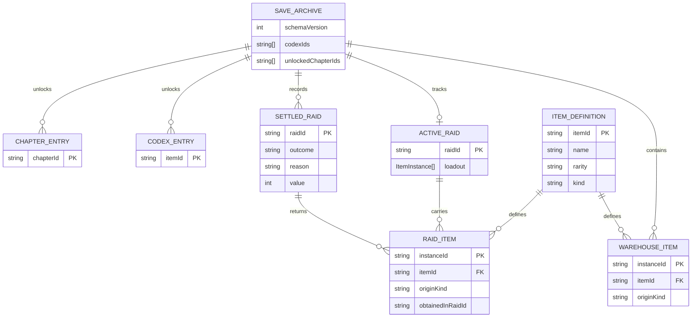

# B 组员数据与存档设计

## 文档目的与范围

本文记录 B 负责的 R03 背包与价值规则、R06 成功/失败结算与存档恢复设计。内容以当前 TypeScript 代码、测试和已冻结的 V1.0 范围为依据，区分“当前已实现”“本轮需要补齐”和“后续计划”。本文只描述浏览器本地 JSON 持久化，不创建或接入 SQL 数据库。

本轮范围为 6 格背包、拾取/丢弃/使用、四档价值计算、带入物排除、成功入库、失败损失、刷新中断和重复结算幂等，对应 R03、R06。二维网格、旋转、商店经济、联机资产和其他第二阶段内容不在本设计的实现范围内。

## B 的设计与交付责任

按照 2026 年 10 月 14 日概要与详细设计分工，B 负责以下内容：

- 概要设计：ER 逻辑图、主要对象/存储结构、字段表、字段约束、版本和一致性说明。
- 详细设计 F2：库存、物品来源、有效价值计算、满包、实例去重和价值变化规则。
- 详细设计 F6：成功/失败结算、带入物扣除、存档写入、刷新中断、迁移和恢复子流程。
- 交付证据：字段表、F2/F6 的流程说明、异常路径、幂等规则和与代码方法名一致的接口说明。

这里的 ER 图是逻辑数据模型。当前项目的物理保存形式是 `localStorage` 中的 JSON 对象，不应把逻辑实体直接描述成已经接入的 SQL 表。

## 逻辑实体与字段

### ItemDefinition 物品定义

`ItemDefinition` 是静态配置中的物品类型定义，不作为每个存档实例重复保存。当前定义位于 `src/config/game-config.ts` 的 `ITEM_DEFINITIONS`。

| 字段     | 类型                                        | 含义与约束                                           |
| -------- | ------------------------------------------- | ---------------------------------------------------- |
| `itemId` | `string`                                    | 物品定义唯一标识，必须在 `ITEM_DEFINITIONS` 中存在。 |
| `name`   | `string`                                    | 展示名称。                                           |
| `rarity` | `common \| uncommon \| epic \| legendary`   | 稀有度，分别对应普通、稀有、史诗、传说。             |
| `kind`   | `collectible \| healing \| quest \| weapon` | 物品类型，决定可收集、恢复、任务或武器用途。         |

当前价值表由 `RAID_RULES.values` 提供：普通 10、稀有 25、史诗 60、传说 150。价值是本局撤离资格的计量值，不是钱包余额或历史累计收入。

### ItemInstance 物品实例

`ItemInstance` 表示一个可被拾取、带入、丢弃、使用和结算的具体实例。实例身份必须贯穿整个流程。

| 字段                      | 类型         | 含义与约束                                                     |
| ------------------------- | ------------ | -------------------------------------------------------------- |
| `instanceId`              | `string`     | 实例唯一标识；同一实例不能在同一状态中出现两份。               |
| `itemId`                  | `string`     | 引用一个已知 `ItemDefinition`。                                |
| `origin`                  | `ItemOrigin` | 实例来源，只有 `carry-in` 或 `raid-loot`。                     |
| `origin.kind`             | `string`     | `carry-in` 表示开局从永久仓库带入；`raid-loot` 表示本局获得。  |
| `origin.obtainedInRaidId` | `string`     | `raid-loot` 必须填写非空的获得对局 ID；`carry-in` 不带此字段。 |

来源决定价值和结算：只有 `origin.kind = raid-loot` 且 `obtainedInRaidId` 等于当前 `raidId` 的实例计入本局价值；带入物不计入本局价值。

### warehouse 永久仓库

`warehouse: ItemInstance[]` 保存成功结算后进入永久档案的实例。开局带入时，指定实例从 `warehouse` 移出，并以同一 `instanceId` 改写为 `origin.kind = carry-in` 的活动局实例。成功结算时，仍携带且通过校验的实例重新写入 `warehouse`；失败结算不会把本局新物资写入仓库，已带入但未带回的物品也按失败规则损失。

约束：

- `warehouse` 内所有 `instanceId` 唯一。
- 每个实例的 `itemId` 必须对应当前已知物品定义。
- 仓库中不能保留同一个 `instanceId` 的重复副本。
- 成功结算写入前必须检查实例不能与现有仓库冲突。

### activeRaid 当前对局和带入物

正式 schema 3 的结构为：

```ts
activeRaid: {
  raidId: string;
  loadout: ItemInstance[]; // 每项必须是 carry-in
} | null
```

`activeRaid` 表示已确认开局、但尚未结算的对局。`beginRaid()` 成功后，带入物已经从仓库扣除，并以 `loadout` 快照记录。`loadout` 中的实例必须唯一、不能超过 6 件、不能与剩余 `warehouse` 重叠，且每项来源必须是 `carry-in`。

如果页面刷新或重新打开时 `activeRaid` 仍存在，应用调用 `recoverInterrupted()`，将该对局记为 `interrupted` 失败并清除活动局；当前规则不猜测返还带入物。

参考适配器 schema 1 的 `activeRaid` 只有 `{ raidId }`，没有可信的 `loadout` 清单；它是旧的参考存档格式，正式运行时使用 schema 3。

### settledRaidIds 已结算对局

`settledRaidIds: string[]` 保存已经完成成功或失败结算的 `raidId`。数组元素必须唯一。它用于阻止同一对局重复开始，也用于让 `finalizeRaid()` 对重复请求安全幂等。

### lastResult 最近一次结算结果

`lastResult: RaidResult | null` 保存最近一次已经写入存档的结果：

| 字段            | 类型                    | 含义与约束                                                                   |
| --------------- | ----------------------- | ---------------------------------------------------------------------------- |
| `raidId`        | `string`                | 对应已结算对局，必须出现在 `settledRaidIds`。                                |
| `outcome`       | `success \| failed`     | 成功或失败。                                                                 |
| `reason`        | `FailureReason \| null` | 成功必须为 `null`；失败为 `death`、`timeout`、`abandoned` 或 `interrupted`。 |
| `items`         | `ItemInstance[]`        | 成功时为带回实例；失败时必须为空数组。实例 ID 不重复。                       |
| `value`         | `number`                | 本局结算时记录的非负安全整数价值。                                           |
| `questComplete` | `boolean \| undefined`  | 可选的本局任务完成标记。                                                     |

### codexIds 与 unlockedChapterIds

- `codexIds: string[]`：成功带出后点亮的物品定义 ID，数组内唯一；只记录 `itemId`，不替代仓库实例。
- `unlockedChapterIds: string[]`：成功满足证据和任务条件后永久解锁的章节 ID，数组内唯一；失败结算不会回退已经解锁的章节。

当前思源密码章节的解锁需要结算结果中包含本局的 `torn-notebook` 和 `anomalous-feather`，并满足任务完成条件。章节解锁和物品入库与本次结算一起提交。

## 逻辑关系图

下图表示逻辑关系，不代表当前项目已创建关系数据库表：



当前 JSON 实际上将 `warehouse`、`activeRaid`、`settledRaidIds` 和 `lastResult` 作为同一个存档对象的字段保存，不是分别写入独立表。

## 存档版本和保存键

当前正式保存常量如下：

| 项目        | 当前值                              | 说明                                                  |
| ----------- | ----------------------------------- | ----------------------------------------------------- |
| 正式保存键  | `bjtu-treasure-hunt:save:v2`        | `PersistentSave` 使用；键名保持稳定以支持原地迁移。   |
| 正式 schema | `3`                                 | `FORMAL_SCHEMA_VERSION`；`activeRaid` 含 `loadout`。  |
| 参考保存键  | `bjtu-treasure-hunt:a-framework:v1` | `ReferenceSave` 使用的旧参考命名空间。                |
| 参考 schema | `1`                                 | 旧格式的 `activeRaid` 不保存带入清单。                |
| 存储介质    | 浏览器 `localStorage`               | 通过 `StoragePort.getItem/setItem` 读写 JSON 字符串。 |

当前项目使用 **localStorage JSON 存档，不是 SQL 数据库**。本轮不创建 MySQL、SQLite 或其他 SQL 数据库，也不接入 IndexedDB 或服务端资产存储。

## 接口和保存时机

当前公共保存接口为：

```ts
interface SavePort {
  beginRaid(raidId: string, loadoutIds: readonly string[]): Promise<readonly ItemInstance[]>;
  finalizeRaid(result: RaidResult): Promise<void>;
}
```

### beginRaid 开局扣除

1. 校验 `raidId` 非空、当前没有其他活动局、对局未结算、带入数量不超过 6 且 ID 不重复。
2. 按 `loadoutIds` 从 `warehouse` 查找实例；缺失实例直接拒绝，不写入部分结果。
3. 复制实例并将来源改为 `carry-in`，从仓库移除原实例。
4. 写入 `activeRaid = { raidId, loadout }`。
5. 只有完整 JSON 写入存储成功后，内存状态才替换；写入失败时保留原状态。

### 成功结算流程

1. `finalizeRaid()` 检查 `raidId` 与当前 `activeRaid` 匹配。
2. 校验结果实例 ID 唯一；`carry-in` 必须与活动局 `loadout` 的实例 ID 和物品 ID 匹配；`raid-loot` 必须来自当前 `raidId`，且不能冒充带入物。
3. 检查结果实例不能与当前仓库实例重复。
4. 将结果物品写入 `warehouse`，同步新增 `codexIds`。
5. 若任务证据和任务完成条件满足，加入 `unlockedChapterIds`。
6. 清除 `activeRaid`，追加 `settledRaidIds`，保存 `lastResult`。
7. 以上内容构造为一个完整的 next 对象，存储成功后才报告结算成功。

### 失败结算流程

1. 失败结果的 `outcome` 为 `failed`，`reason` 必须是允许的失败原因。
2. 失败结果的 `items` 必须为空，不能把本局物资写入仓库。
3. 清除 `activeRaid`，追加 `settledRaidIds`，保存 `lastResult`。
4. 已经在仓库中但未带入的物品保持不变；已带入的物品因本局失败而损失。

### 刷新中断流程

1. 页面重新打开后读取正式存档。
2. 如果存在 `activeRaid`，调用 `recoverInterrupted()`。
3. 清除 `activeRaid`，以 `interrupted`、空物品列表和 0 价值写入失败结果，并将 `raidId` 加入 `settledRaidIds`。
4. 不自动返还活动局带入物，也不修改未带入仓库物品。
5. 写入失败时不替换内存状态，待存储恢复后再处理。

### 重复结算流程

1. `finalizeRaid()` 先检查 `settledRaidIds`。
2. 如果 `raidId` 已结算，直接返回，不再次增加仓库物品、图鉴或章节。
3. 如果 `raidId` 未结算但不匹配当前活动局，拒绝结算并保持原存档。

## 当前已实现

- `ItemDefinition`、`ItemInstance`、物品来源和四档价值配置已存在。
- `ReferenceInventory` 已实现 6 件容量、拾取、移除/丢弃、恢复物消耗、装备引用和实例来源校验。
- `calculateExtractionValue()` 已排除带入物和其他对局物品，并按 `instanceId` 去重、拒绝冲突实例。
- `PersistentSave` 已使用正式键和 schema 3，支持 v2 迁移、v1 参考存档导入、正式 JSON 校验、导出、重置和中断恢复。
- 成功入库、失败损失、图鉴更新、章节解锁、重复结算幂等和写入失败后的重试已有代码与集成测试覆盖。
- `main.ts` 已通过 `PersistentSave(localStorage)` 启动，提供带入选择、使用恢复物、丢弃、保存失败重试和 v3 JSON 导出。

## 本轮需要补齐或确认

本轮只围绕 R03、R06 做核对和必要补齐，不预设要重写已有模块：

- 对照冻结验收标准确认满包、拾取失败、丢弃、使用、带入物排除、重复拾取和价值即时重算的实际调用链。
- 确认成功、失败、刷新中断和重复结算在正式 `PersistentSave` 链路上都保持实例唯一和仓库一致。
- 补齐当前测试没有覆盖或证据不足的关键边界，并保持失败写入时原存档和内存不被提前替换。
- 保持 `localStorage` JSON 方案，必要时只补充当前 schema 3 已能表达的字段或校验，不在本轮引入新存储技术。
- 保持设计文档、字段约束、接口方法名和测试场景一致。

## 后续计划 仅记录不实现

以下内容属于第二阶段，不在本轮代码或存档设计中实现：

- 二维网格、物品宽高、旋转和正式布局持久化。
- 装备槽交换的完整交互和服务端校验。
- 商店、钱包、交易记录和升级配置。
- 联机资产事务、服务端权威存档和跨设备恢复。
- IndexedDB 或服务端资产事务。
- SQL 数据库。

后续若确认这些功能，必须重新评估 schema、接口、UI、测试和迁移方案，不能把本轮的 localStorage JSON 设计直接宣称为已支持第二阶段能力。

## 当前风险与待确认事项

- `inventory-model.ts` 已定义按 `instanceId` 存储和位置引用的逻辑模型，但明确尚未接入 `ReferenceInventory`；本轮不将其误写成已实现的二维网格。
- `InventoryPort` 公共接口未声明 `equip()`、`unequip()` 和 `consumeHealing()`，当前 UI 通过具体的 `ReferenceInventory` 使用这些能力；Step 5 需先确认是否真的需要扩展公共接口。
- `ReferenceSave` schema 1 是旧参考适配器，和正式 schema 3 的物品来源严格性、活动局清单和结算校验不完全相同；两者不能混称为同一正式物理结构。
- 当前 schema 3 已能表达本轮 R03/R06 所需的仓库、活动局、结算和恢复数据，暂不建议为了第二阶段字段提前升 schema。
- 如果教师要求“关系数据库”而非浏览器 JSON，需要先获得明确口径，再另行设计数据库部署位置、表结构、迁移和接口；本轮不擅自创建 SQL 数据库。
