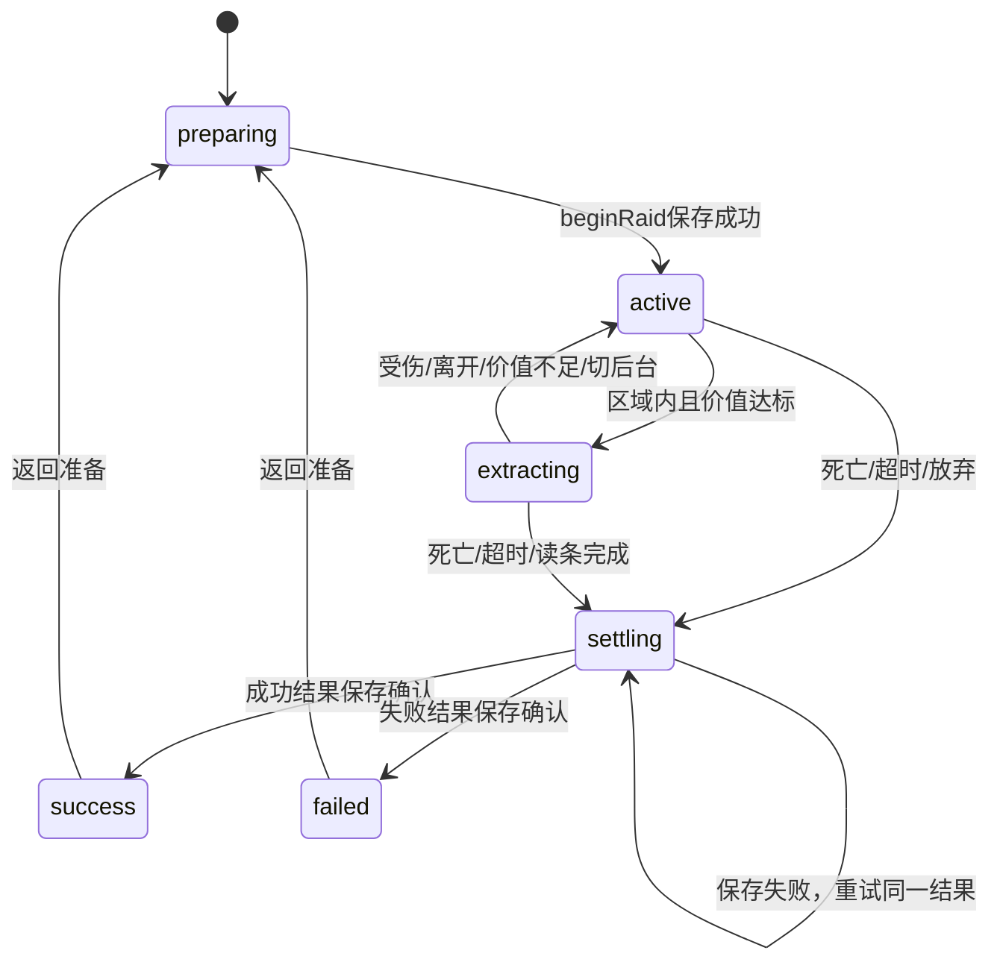

# 模块接口与替换说明

## 状态所有权

A 的 RaidController 是唯一对局状态决策者。库存变更只能由 InventoryPort 的实现完成，永久数据只能由 SavePort 写入。场景负责接线，UI 通过 getView() 和只读复制快照展示。

## B 接入

实现 `InventoryPort` 和 `SavePort` 后在 `src/main.ts` 的组装处替换 reference 适配器，不能在主场景内复制一套库存。

- `beginRaid(raidId, loadoutIds)`：持久化扣除带入物并记录activeRaid后才resolve，失败reject。返回来源为carry-in的物品副本。
- `getCarriedItems()`：返回当前真实携带物，包括正式装备栏；同一instanceId可能被别处引用，价值函数会去重。不得返回可直接改动内部状态的数组。
- `addLoot(item)`：实际是拾取入口，也用于从地面拾回带入物，必须保留来源。检查容量成功后插入并发InventoryChanged；失败不移除地面物品。
- `remove(instanceId)`：丢弃／消耗使用同一个库存出口，返回实际移除物并发InventoryChanged。
- `finalizeRaid(result)`：用raidId保证幂等，保存成功后才resolve。result由A内部快照构造，不能从UI传入自报得分。
- 图鉴仅在成功带出时更新。正式章节需D给出满足条件的任务证据，并和库存放进同一对象保存；目前reference存档故意不解锁剧情。

`reference-save.ts` 仅用于本地联调，不是完整装备、经济系统和跨版本迁移。它不把localStorage当成防篡改服务器。迁移到正式命名空间前，B要决定是否导入联调档；不要直接覆盖真实数据。

## C 接入

- 实际命中后调用 `controller.applyDamage(amount)`，A 更新生命镜像并发布 DamageTaken；监听者只显示反馈／取消搜索，不再次扣血。C若改成独立生命服务，先与A一起修改这个单一入口。
- C 管理敌人状态和攻击冷却；一次攻击只能调用一次伤害入口。死亡、场景退出与对局结束时停止AI及计时器。
- 掉落生成稳定 instanceId，origin 为当前 raidId 的 raid-loot，实际拾取才调用库存入口；不要在击杀时直接累加撤离分值。
- 抱抱请求、1.5秒长按、变异状态由C实现，D呈现。对局结束后不能继续触发交互。

## D 接入

- `getView()` 是UI快照，`InventoryChanged`是重新取库存的通知；快照不能写回业务层。
- 只从值表展示单件价值，门槛显示读controller的threshold。当前参考壳是固定首版文案；若增加可选难度，应同步去掉其固定100文字。
- 地点调查发布 `LocationInteracted`。任务状态需要真实前置证据；拾到手记并不等于已经调查石碑。
- 成功带出后才能解锁章节，不能仅监听ItemPicked永久点亮。参考版没有完成这个实现。

## E 接入

CI 已有npm ci及完整check；正式发布由E配置，不在本框架中自动上线。浏览器验证时分别检查dev和preview：正式构建隐藏开发伤害入口，仍有正常失败／放弃路径。

优先验收localStorage不可写、损坏存档、刷新中断、重复结束、第二标签页、后台超时、低帧率碰撞、子目录资源路径。游戏只承诺桌面键鼠，移动端布局自适应不代表已实现触控操作。

## 本次统一的契约修正

旧 `A工作包/raid-contract.ts` 只是草案：没有位置判定、取消时刻或持久化生命周期，不能直接当完整撤离实现。本仓库以新文件为准：

- 保留 itemId／instanceId／raidId，来源统一为 `carry-in` 和 `raid-loot`。
- 删除重复的单件数值来源；定义只含rarity，本局快照的values是分值唯一来源。
- 撤离资格、取消和完成由同一个状态机管理，完成时再校验生命、剩余时间、区域和真实库存。
- 未知物品的计分直接报错，不静默算0；真实库存适配器在插入前拒绝未知定义。
- 计分函数放B的模块内，A依赖它而不复制实现；状态机与Phaser解耦。

该修正是在空仓库中首次落地，并未迁移已有组员代码；修改这些契约仍需通知其他成员。
